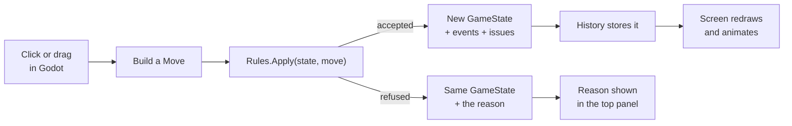

# Terra Mysticalculator

A desktop board for **Terra Mystica**: set up any game, play it out move by move under the full rules, explore
alternative lines, and replay real games imported from Board Game Arena. Built for commentating and analysing games
(chess-broadcast style), and as a calculator for working out what a turn could achieve.

Built with **Godot 4.7 (.NET / C#)** on top of a standalone, fully tested rules engine.

> Unofficial fan project. Not affiliated with or endorsed by Feuerland Spiele, the publishers of Terra Mystica, or
> Board Game Arena. Terra Mystica was designed by Jens Drögemüller and Helge Ostertag.

---

## Contents

- [What it does](#what-it-does)
- [What is supported](#what-is-supported)
- [Getting started](#getting-started)
- [Using the app](#using-the-app)
- [Importing games from Board Game Arena](#importing-games-from-board-game-arena)
- [File formats](#file-formats)
- [How it is built](#how-it-is-built)
- [Repository layout](#repository-layout)
- [Tests](#tests)
- [Working on the code](#working-on-the-code)
- [Status and known limitations](#status-and-known-limitations)
- [Roadmap](#roadmap)
- [Credits](#credits)
- [Licence](#licence)

---

## What it does

### A complete, rules-enforcing board

- Every action, free action and bonus action of Terra Mystica, with all income, cult rewards, town formation, power
  offers and final scoring worked out automatically.
- Pieces are dragged and clicked as on the table: dwellings onto hexes, priests onto cult tracks, key tokens onto
  towns, bridges onto river crossings.
- Every legal destination lights up while a piece is held, with its cost shown over the hex.
- A refused move says why ("The Shapeshifters need 5 power in bowl 3 (burning included)."), in the message line
  across the top of the map.
- Victory points fly from what scored them to the player's VP count, so every point can be followed on screen.

### Three play modes

A slider on the top panel switches between:

| Mode | What it allows |
|---|---|
| **Strict** | The rules exactly as printed. Any move that would leave a player in debt (coins, workers, priests) or below 0 VP is refused. |
| **Lenient** | The rules, but debt and negative VP are allowed with a warning. Useful for "what if they had one more worker?" |
| **Free** | Planning during a game: any faction can take any number of ordinary actions, in any order, with normal costs and rewards. Leaving Free hands the turn back to whoever had it. |

### Calculator

One faction alone against a **neutral opponent**: drop neutral dwellings, bridges and priests anywhere to stand in
for the other players, then work out exactly how far a turn, a round or a whole game can go.

- Any number of round tiles (missing rounds are blank).
- All the pass tiles, or any selection of four or more.
- A **+1 bar** above the board: click to give the faction a coin, a worker, a priest or a power.
- Always in Free mode, with an optional Strict variant that only allows extra power.

### Setting up a game in progress

Record a position from a game already under way, without replaying it from the start. Every value is set directly:

- resources, power bowls, priests;
- cult track steps and favours;
- shipping and spade levels;
- buildings, bridges and the terrain of every hex;
- key tokens and towns;
- the round, the pass tiles and the coins on them;
- who has passed, and which power actions and bonus actions are already used.

The game checks the position is consistent before play can go on. Each problem is listed in turn ("Town without a
key", "Two factions on a step 10", …). A turn-order step then sets who acts next.

### History, bookmarks and a game line

- **Undo and redo** any number of moves.
- **Branching:** a different move from an earlier position starts a side line, and nothing is ever thrown away.
- **Bookmarks:** made automatically at the start of the game and of each round, and by hand with **B**. They can be
  renamed and deleted.
- **The bookmark map** (**M**): a drawing of every line and bookmark. Click any bookmark to jump there.
- **The log** (**L**): every move in words ("Giants build a dwelling at E5 · +2 VP (round bonus)"). Each record
  has a jump arrow to go straight to it, and a ribbon to bookmark it.
- **The game line:** marks the line that was actually played, for commentary. Wandering off it to show an alternative
  is flagged in the message line ("Off the game line (3 moves)"), and **Back to game line** returns.

### Saving and loading

- Saves hold the whole history tree, with every line and bookmark, as readable JSON (`.tmcalc`).
- An **autosave** runs in the background two seconds after every change.
- Loading replays every move through the current rules. If a rule has changed since the save was made, it stops at
  the first move the rules now refuse and says which one.

### Custom maps

A map editor paints any 9-row map, either 13-top or 12-top: choose a terrain on the colour wheel and click or drag
over hexes. Every terrain needs at least three hexes.

- Strokes can be undone and redone.
- Maps save and load as their own files (`.tmmap`), for reuse across games.
- The custom map is saved inside the game too.

### End-of-game scores and statistics

When a game ends, a scoreboard opens with three tabs:

| Tab | Shows, for each faction |
|---|---|
| **VPs** | Where every victory point came from: round bonuses, favours, pass tiles, towns, upgrades, abilities, the end-game cult, network and resource scoring |
| **Actions** | Every kind of action taken: buildings by type, terrain transforms, towns, favours, each power action |
| **Resources** | Coins, workers, priests and power gained, by source |

Factions are in the first round's turn order, each with its portrait, final VP and placing. During the game, each
portrait's **score badge** previews what final scoring would give right now.

---

## What is supported

### Games and expansions

| Content | Status |
|---|---|
| Terra Mystica base game | Complete |
| Mini-expansions (extra town tiles, round tile, pass tile) | Complete, on by default |
| Fire & Ice: factions and the four final scoring tiles | Complete |
| Special Landscapes (one landscape per published faction) | Complete |
| Fan factions (the 20 played on Board Game Arena) | Complete |
| Variable turn order (pass order becomes the next round's order) | Complete, on by default |

Special Landscapes and fan factions cannot be combined in one game.

### Factions (40)

| Set | Factions |
|---|---|
| Base game (14) | Auren, Witches, Giants, Chaos Magicians, Nomads, Fakirs, Halflings, Cultists, Alchemists, Darklings, Mermaids, Swarmlings, Dwarves, Engineers |
| Fire & Ice (6) | Ice Maidens, Yetis, Dragonlords, Acolytes, Riverwalkers, Shapeshifters |
| Fan factions (20) | Architects, Treasurers, Djinni, Archivists, Time Travellers, Prospectors, Goblins, Children of the Wyrm, Wisps, Atlanteans, Chash Dallah, Enlightened, Conspirators, Dynion Geifr, Selkies, Snow Shamans, Firewalkers, Kingdom of Ember, Geologists, Changelings |

Every faction's board is drawn in code from its data: costs, incomes, stronghold bonus and special abilities.

### Maps

| Map | Notes |
|---|---|
| Base Map | The original printing |
| Revised Base Map | The corrected later printing |
| Fire & Ice | Side 1 |
| Fjords | |
| Lakes | |
| Archipelago | |
| Custom | Any map made in the editor |

### Rulings

Where the printed rules are silent or ambiguous, Board Game Arena's behaviour has generally been followed, and checked
against 188 recorded games. The exceptions are deliberate rulings, recorded in the code next to the rule they affect.

---

## Getting started

### Requirements

| Tool | Version | Used for |
|---|---|---|
| [Godot Engine, .NET edition](https://godotengine.org/download) | 4.7 | Running and editing the app |
| [.NET SDK](https://dotnet.microsoft.com/download) | 10 | Building the C# projects and running the tests |
| Windows | 10 or 11 | The helper `.bat` scripts and the default renderer (Direct3D 12) |

The standard (non-.NET) Godot build will not open the project: it is written in C#.

The rules engine and tests are plain .NET and run anywhere .NET does. The app itself has only been used on Windows.

### Run the app

1. Clone the repository:
   ```
   git clone https://github.com/percyrich/terramysticalculator.git
   ```
2. Open Godot (.NET edition), choose **Import**, and select `tm-calc/project.godot`.
3. Godot builds the C# projects on first open. If it doesn't, use **Build** in the top-right corner of the editor.
4. Press **F5** (or the play button) to run.

### Run the tests

From the repository root:

```
run-tests.bat
```

This runs every rules test, then builds the Godot project to check it still compiles against the rules engine. The
outcome is written to `test-results.txt`. Without the script:

```
dotnet test Core.Tests/Core.Tests.csproj
dotnet build tm-calc/TMCalc.csproj
```

---

## Using the app

### Setting up a game

The **step button** at the left end of the top panel moves setup along. It shows dots while something is still to do,
and a tick once the step can be confirmed.

1. **Game:** Terra Mystica, and the options under it:
   - variable turn order;
   - mini-expansions;
   - Landscapes;
   - Fire & Ice and its final scoring tile;
   - fan factions;
   - setting up a game in progress;
   - Calculator (and its Strict variant).

   The rules slider sets the mode to start in.
2. **Factions:** click portraits to add them. Ice and variable factions choose a starting terrain on a colour wheel
   straight away; volcano factions choose theirs once every faction is in.
3. **Turn order:** click the factions in the order they will play. Starting VP can be adjusted here for auctions:
   left-click +1, right-click −1, with Shift ×10.
4. **Map:** click a miniature, or **Custom map** to paint one.
5. **Round tiles:** click six, in round order.
6. **Pass tiles:** click the tiles in the game (the number of players plus three).
7. **Start:** place the starting dwellings, then each player picks a pass tile, in reverse turn order.

### Playing

| To | Do this |
|---|---|
| Build a dwelling | Drag the leftmost dwelling from the faction's board onto a hex. If the hex needs transforming first, the spades are paid as part of the build. |
| Transform a hex | Click the hex: a colour wheel shows every terrain it can become and the cost. A hex turned to home terrain then offers a dwelling. |
| Upgrade a building | Click one of your buildings on the map. The buildings it can become appear over it; click one. |
| Send a priest | Drag a priest from the faction's board onto a cult track's slot. |
| Upgrade shipping or spades | Click the shipping or spade icon on the faction's board. |
| Take a power action | Click it on the board. |
| Use a bonus action (octagon) | Click the octagon on the faction's board, then its target. |
| Convert power | Click power bowl III. A menu offers a priest, a worker or a coin; burning happens automatically if needed. |
| Burn power | Click bowl II. The token that will be removed lights up in red first. |
| Convert a worker to a coin | Drag a worker onto the coin count. |
| Form a town | Drag a key token from the bank onto one of the town's hexes. |
| Place a bridge | Drag a bridge from the supply onto a lit crossing. |
| Answer a power offer | Click the chip on the map to accept the power (for its VP cost); click any hex to decline. The Nomads' Trading Camp adds a second chip for a coin instead. |
| Take a favour | Click a favour tile in the bank. |
| Pass | Click the faction's own pass tile, then (rounds 1 to 5) click the new one to take from the bank. |
| End the turn | Click the faction's **player button** once it shows a tick. |
| Look at another player's board | Click their compact board to open it in full; Esc closes it. |
| Preview final scores | Click a faction's score badge, under its VP. |

Whose turn it is, and what they have to do next, is always shown on the top line of the top panel.

### Keyboard shortcuts

| Keys | Action |
|---|---|
| Ctrl+Z | Undo one move |
| Ctrl+Y or Ctrl+Shift+Z | Redo one move |
| B | Bookmark the current position |
| M | Open or close the bookmark map |
| L | Open or close the log |
| Ctrl+S | Save (to the last file saved or loaded) |
| Ctrl+Shift+S | Save as |
| Ctrl+O | Load |
| Esc | Close the open map, log, menu or message box |
| Shift (while clicking a count in setup) | Change it by 10 |

In the custom map editor, Ctrl+Z and Ctrl+Y undo and redo brush strokes, and Ctrl+S, Ctrl+Shift+S and Ctrl+O save and
load the map file instead of the game.

### Setting up a game in progress: controls

Select a faction by clicking its board, then:

| To change | Do this |
|---|---|
| VP, coins, workers | Left-click +1, right-click −1 |
| Power tokens | Click a bowl to add a token; drag a token to another bowl to move it, or off the bowls to remove it |
| Shipping and spade level | Left-click the icon +1, right-click −1 |
| Cult track steps | Left-click the track +1, right-click −1 |
| Priests | Click the supply to gain one; drag one onto a slot; right-click one to send it back |
| Buildings | Drag from the board onto a hex; drag on the map to move; right-click to return; click to change its type |
| Terrain | Click an empty land hex for the colour wheel |
| Favours, bonus actions, power actions, pass tiles | Click to take or toggle; right-click to return |
| Key tokens | Drag from the bank onto a hex; right-click the hex to return it |
| The current round | Click its round tile |

The step button becomes **Done**. Each press shows the next problem still to fix, and play begins once there are
none.

---

## Importing games from Board Game Arena

Finished games and games in progress on [Board Game Arena](https://boardgamearena.com) (BGA) can be converted into a
save and replayed move by move. BGA has no public API, so the data is collected from the browser while logged in, with
a **bookmarklet**: a bookmark that runs a small script on the current page.

### 1. Install the bookmarklet (once)

1. In the app, open the bookmark map (**M**) and press **BGA Bookmarklet**, then **Copy to Clipboard**. The same text
   is in [`BgaImport/bookmarklet.min.txt`](BgaImport/bookmarklet.min.txt); the readable source is
   [`BgaImport/bookmarklet.js`](BgaImport/bookmarklet.js).
2. In Chrome, show the bookmarks bar (Ctrl+Shift+B), right-click it, and choose **Add page…**.
3. Name it (for example "TM export") and paste the copied text as the URL. It begins `javascript:`.

### 2. Export a game

- **Finished game:** open the game's replay on BGA, wait for the board to appear, then click the bookmark before
  stepping through any moves.
- **Game in progress:** open the game, wait for the board, then click the bookmark.

A file named `bga-<table>.json` downloads. It holds the full move log and the game's setup data.

BGA limits how many replays an account can open a day (about 100).

### 3. Load it

**In the app:** bookmark map → **Load BGA JSON** → choose the file. The game is converted and opened at its last move,
with the played moves marked as the game line, in Strict mode. A save (`bga-<table>.tmcalc`) is written beside the
`.json`.

If the conversion stops part-way, or the final scores differ from BGA's, a message explains where and why. Its report
can be copied for a bug report.

**From the command line:**

```
run-bga-import.bat bga-<table>.json
run-bga-import-all.bat <folder>
```

The first converts one file; the second converts every `.json` in a folder and writes a one-line summary per game.
The output goes to `BgaImport/out/`:

| File | Contents |
|---|---|
| `bga-<table>.tmcalc` | The save |
| `bga-<table>-report.txt` | The setup read from BGA, every problem and difference found, and the final scores side by side |
| `bga-<table>-trace.txt` | Every move made, with BGA's move number and log line |
| `summary.txt` | The batch tool only: OK, STOP or FAIL for each game |

The exit code is 0 when the whole game converted, and 3 when the conversion stopped part-way.

### How the conversion works

The converter does not trust BGA's numbers; it re-plays the game.

1. **Setup** is read from BGA's game data: options, factions, auction bids, the map (matched hex by hex against the
   known maps, or recreated as a custom map), round tiles and pass tiles.
2. **Each BGA notification** is turned into the equivalent move and played through this project's own rules engine.
3. **Automatic effects** (income, cult rewards, VP, town bonuses, final scoring) are not copied from BGA. They are
   worked out by the rules engine.
4. **Every packet is checked** against BGA's counts for each player: coins, workers, priests, power bowls, free
   spades, VP and cult steps. Any difference is reported when it appears.
5. **A move the rules refuse** stops the conversion there; everything up to that point is kept.

### Results

Against a test set of **188 recorded BGA games** across every faction, map and expansion:

- **179** convert to the end;
- **176** of those finish with every final score equal to BGA's.

The games that stop or differ are understood. They involve older versions of three fan factions (BGA has since
changed them), older tables scored under a different reading of the Mermaids' Coral Reef, one BGA scoring quirk, and
one game whose stop is accepted. All 188 games are in [`BgaConvert/samples`](BgaConvert/samples).

---

## File formats

Both formats are indented, human-readable JSON.

### Game saves (`.tmcalc`)

```json
{
  "Format": "tmcalc",
  "Version": 1,
  "History": {
    "Positions": [
      { "Id": 0, "Parent": null, "Moves": [], "Bookmark": "Session start", "Next": 1 },
      { "Id": 1, "Parent": 0, "Moves": [ { "$type": "ChooseGame", "Game": "TerraMystica", "Options": { … } } ], … }
    ],
    "Current": 214,
    "GameEnd": 214,
    "Used": { … }
  }
}
```

A save stores **moves, not positions**. Loading replays them through the rules. Each position records its parent,
the moves that led to it, its bookmark name if any, and which child redo follows. The game line's end is `GameEnd`.

Moves are stored by their record name (`"$type": "BuildDwelling"`). Renaming a move type in the code would make older
saves unreadable.

### Map files (`.tmmap`)

```json
{
  "Format": "tmmap",
  "Version": 1,
  "Rows": [ "PMFLDWPSPFLMS", "DRRPSRRDSRRD", … ]
}
```

One string per row, one letter per hex:

| Letter | Terrain |
|---|---|
| W | Wasteland |
| D | Desert |
| P | Plains |
| S | Swamp |
| L | Lake |
| F | Forest |
| M | Mountain |
| R | River |

---

## How it is built

### Design principles

1. **The rules know nothing about the screen.** The rules engine (`Core`) is a plain .NET library with no Godot
   references. It can be tested, and reused by the BGA converter, without any graphics.
2. **A position is a value.** The whole game at one instant is one immutable record (`GameState`). A move never
   changes a position; it produces a new one. Undo is therefore free, and comparing two positions is exact.
3. **One door in.** Every move goes through a single function, `Rules.Apply(state, move)`. It returns the new
   position, the events that happened (for animation and the log), and any issues: notes, warnings or errors.
4. **Strictness is a policy, not a rewrite.** Strict, Lenient and Free use the same rules; they differ only in which
   issues refuse a move.
5. **The screen redraws from the position.** The Godot side holds no game data of its own. After every move it
   draws the new position, and uses the move's events to choose animations.

### How a move travels



Queries work the same way: "where can this piece go?" is answered by trying each candidate move through
`Rules.Apply` and keeping the accepted ones. The highlights on screen can therefore never disagree with the rules.

### The projects

| Project | Kind | Purpose |
|---|---|---|
| `Core` | .NET 8 class library | The rules: data, positions, moves, rules, history, saving, the game log, statistics |
| `Core.Tests` | xUnit test project | Tests for the rules |
| `tm-calc` | Godot 4.7 C# project | The app: drawing, animation, input |
| `BgaConvert` | .NET 8 class library | Converts a BGA game into a history, shared by the app and the console tool |
| `BgaImport` | .NET console app | The command-line converter and the bookmarklet's source |

### Art

The board is drawn entirely in code: hexes, buildings, cult tracks, faction boards, tiles, icons and the special
landscapes. Only the faction portraits are image files, made for this project. Every drawing is generated at the size
it is shown, so it stays sharp at any zoom.

---

## Repository layout

```
.
├── Core/                     The rules engine (see Core/README.md)
│   ├── Data/                 What is printed on the components: factions, tiles, maps, every fixed number
│   ├── State/                What a position is: GameState, PlayerState, power bowls, pieces
│   ├── Moves/                Every move, what a move returns, and the events it reports
│   ├── Rules/                What each move does, one file per topic (start at Rules.cs)
│   └── Record/               History, saving, map files, the game log, final scoring, statistics
├── Core.Tests/               Tests for the rules, one file per topic
├── tm-calc/                  The Godot app
│   ├── project.godot
│   ├── scenes/               main.tscn (the board), player_panel.tscn, the tile scenes
│   ├── scripts/              The C# scripts (see tm-calc/scripts/README.md)
│   │   ├── Main/             The main scene's script, one file per area: input, pieces, tiles, setup, history, …
│   │   ├── Board/            The map, colour wheel, cult tracks, priest zones, map editor
│   │   ├── PlayerPanel/      A player's board: buildings, power bowls, player button, score badge
│   │   ├── Tiles/            Favour, key, pass and round tiles, power actions
│   │   ├── TopPanel/         The top bar, log, bookmark map, message boxes, end-game scores
│   │   ├── Parts/            Shared building blocks: icon-and-number bundles, highlights, the light animation
│   │   └── Art/              Everything drawn in code
│   └── sprites/              The faction portraits
├── BgaConvert/               The BGA converter library, and 188 sample games in samples/
├── BgaImport/                The command-line converter and the bookmarklet (see BgaImport/README.md)
├── run-tests.bat             Runs the tests and builds the app
├── run-bga-import.bat        Converts one BGA game
└── run-bga-import-all.bat    Converts a folder of BGA games
```

Each of the three main folders has its own README with a file-by-file map:

- [`Core/README.md`](Core/README.md)
- [`tm-calc/scripts/README.md`](tm-calc/scripts/README.md)
- [`BgaImport/README.md`](BgaImport/README.md)

---

## Tests

`Core.Tests` holds over 600 tests (625 at the last run), covering:

- every action and free action;
- power, cult tracks, towns, bonus actions, pass tiles and round tiles;
- final scoring, including Fire & Ice's tiles;
- every faction's abilities, including Fire & Ice and the fan factions;
- the special landscapes;
- maps and custom maps;
- the play modes and setting up a game in progress;
- history, saving and loading, the game log and the end-game statistics.

Many tests come from cases found by the BGA conversion, where Board Game Arena and the rules engine first disagreed.

```
run-tests.bat
```

---

## Working on the code

### Where to look

| To change | Go to |
|---|---|
| A cost, limit or reward | `Core/Data/Config.cs`, or `Core/Data/Factions.cs` if it is on a faction board |
| What a move does | `Core/Rules/`: each move is handled by a method named `Apply` + the move's name |
| Why a move is refused | Search `Core/Rules/` for the wording of the message |
| A faction's ability | Search `Core/Rules/` for the faction's name. Fan factions each have a section in `Rules.FanFactions.cs`. |
| A line of the game log | `Core/Record/GameLog.cs` |
| How something looks | `tm-calc/scripts/Art/`, or its node's settings in the Godot Inspector |
| What a click does | `tm-calc/scripts/Main/MainInput.cs`, then the `Main…` file for that part of the board |

### Settings in the Godot Inspector

Sizes, gaps, colours and timings are exposed as Inspector settings on the scene's nodes, grouped by area. Names
follow one rule per kind of value:

| Kind of value | Ends in |
|---|---|
| Duration | `Seconds` |
| Colour | `Colour` |
| Transparency (0 to 1) | `Opacity` |
| Multiplier of a size | `Scale` |
| Nudge from an anchor point | `Offset` |
| Distance between repeated things | `Spacing` or `Step` |
| Distance between two different things | `Gap` |
| Draw order | `ZIndex` |
| Editor-only preview | starts with `Preview` |

Godot saves Inspector values in the scene files **by name**. Renaming a setting in code without renaming it in the
scene files silently resets it to its default.

### Moving or renaming a script

Move its `.uid` file with it, and update its `res://scripts/…` path in any scene that uses it. Otherwise the scene
loses its script.

### Conventions

- **Australian/British spelling** throughout: colour, favour, centre.
- **Comments say what and why**, in plain words, for a reader who is not a programmer.
- **Rulings** that go beyond the printed rules are noted beside the rule, with who decided and when.

---

## Status and known limitations

The base game, Fire & Ice, the special landscapes and all 20 fan factions are complete and play end to end. The app
is in active development, built mainly for its author's own commentary, and has only been used on Windows.

Known gaps:

- **No release builds yet.** Run it from the Godot editor.
- **Setting up a game in progress:** the Riverwalkers' locked terrains and the Shapeshifters' home terrain can't yet
  be set by clicking.
- **Saves** replay their moves on loading, so a rule changed since a save was made can stop the load at that move.
  Snapshots at bookmarks are not implemented yet.
- **BGA import:** older versions of three fan factions (Goblins, Enlightened, Chash Dallah) are detected and reported
  but not played under their old rules. BGA's in-game undo has not been seen in any log so far.
- **The bookmarklet** has been written for Chrome and used there only.

---

## Roadmap

The aim is to cover the whole Terra Mystica family. The rules engine is designed to be extended without touching the
app's drawing code.

- Merchants of the Seas
- Gaia Project and its expansions
- Age of Innovation and its expansions
- Terra Nova

---

## Credits

- **Terra Mystica** is designed by Jens Drögemüller and Helge Ostertag and published by Feuerland Spiele. This
  project is an unofficial fan work and includes none of the published game's artwork.
- **Fan factions** are the work of the Terra Mystica community, as played on Board Game Arena.
- **Board Game Arena** hosts the online games that the importer reads. The bookmarklet only reads what a logged-in
  user's own browser has already loaded.
- **Faction portraits and every drawing** in the app were made for this project.

---

## Licence

Released into the public domain under [the Unlicense](LICENSE): anyone may copy, modify, publish, use, compile,
sell or distribute this code, for any purpose, with no conditions and no need to credit anyone.

The licence covers this repository's own code and art. It does not cover Terra Mystica itself: the game's name and
rules belong to its publisher.
